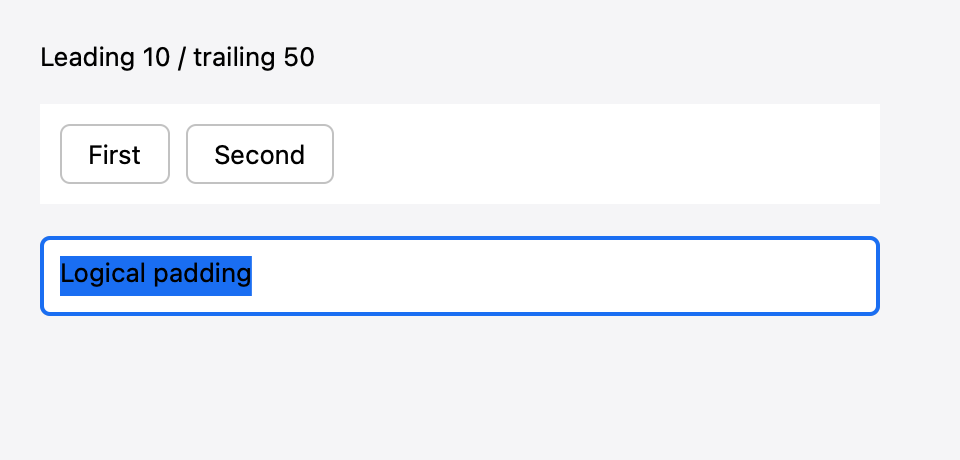
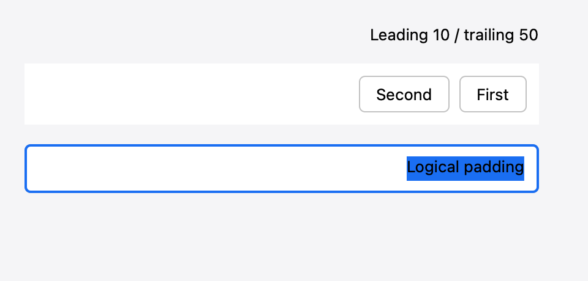

# Directional Layout and Arrangement Verification — 2026-10-31

This change is stacked on PR #26's baseline/scroll-normalization work and addresses
issues #13, #16, and #17. Host: Apple Silicon, Swift 6.4, macOS 27 SDK; deployment
target remains macOS 26.

## Automated checks

- `just check`: formatting, strict Swift tests, valid/invalid API fixtures,
  runtime-fault probes, Calculator build, release build, benchmark harness tests,
  and untimed isolated layout validation.
- Unbounded HStack/VStack coverage: filling text, nested filling stacks, weighted
  spacers with/without minima, finite maxima, explicit dimensions, spacing/padding,
  finalized baselines, and bounded/unbounded/bounded histories with caches on/off.
- Directional content coverage: unequal padding in nested containers, overlays,
  scroll views, labels, CPU canvases, GPU canvases, and text fields. Full and patched
  scenes use identical resolved content bounds. Editor pointer mapping and selection
  drawing agree for leading/center/trailing alignment in LTR/RTL/LTR histories.
- Actual TextService call counts prove direction, scroll, and radius updates reuse
  measurements. Measurement revisions/caches remain stable for pure arrangement
  updates; scroll/direction publish bounds, hit testing, and semantics synchronously.
  Unchanged/clamped wheel input schedules no commit. Exported scrolling baselines
  and dependent container sizing match uncached layout without new text measurements.
- The isolated scrolling benchmark uses arrangement invalidation and asserts zero
  measurement evaluations, independently of timing.

## Native capture

The focused native/scene command passed:

```sh
STANA_GUI_TESTS=1 swift test -Xswiftc -warnings-as-errors --filter 'DirectionalLayoutTests|DirectionalContentTests'
```

The opt-in native test
uses real Core Text and Metal offscreen capture, checks mirrored stack placement,
and verifies the direction transition performs no new layout measurements.
The captures below were visually inspected; they show the same selected editor
and button row with leading 10 / trailing 50 padding.

| LTR | RTL |
| --- | --- |
|  |  |

These are native complete-scene captures, not proof of physical scanout timing.
The full native GUI suite, manual VoiceOver, and interactive OS IME sessions were
not run for this change. Document direction still is not a text-shaping input in
the current TextService contract; text shaping follows the text and native service.
