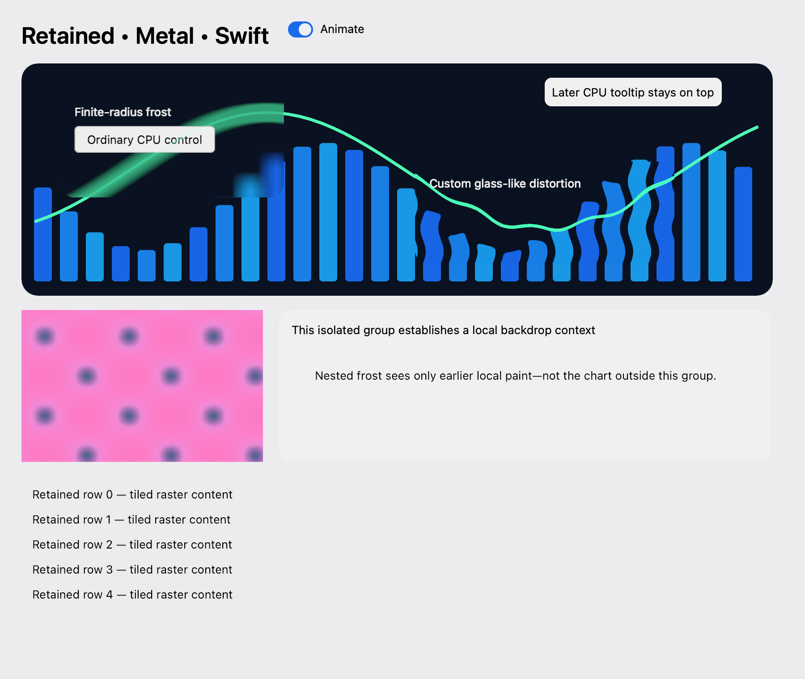

# Hybrid Metal verification — 2026-10-28

## Implementation and environment

The production macOS host now uses worker Core Graphics/Core Text → IOSurface → Metal composition → `CAMetalLayer`. CPU/GPU paint order, retained affine groups, tiled final backing, custom render/compute programs, feedback state, HDR, finite blur, and custom backdrop distortion are implemented. Core Graphics remains an explicit reference renderer, not an automatic fallback.

Local environment: Apple M1 Pro, 16 GiB RAM, macOS 27.0.1, Xcode/SDK 27, Swift 6.4 in Swift 6 mode; deployment target unchanged. Native GUI checks require window-server access. No physical VoiceOver, IME, display-move, or scanout qualification is inferred from offscreen pixels.

## Automated evidence

- `just check` passed: formatting, dependency/native boundaries, warnings-as-errors tests, positive/negative consumer fixtures, isolated runtime-fault probes, all six external examples, and release build. The complete GUI-enabled run passed 125 tests; the final renderer-only validation run passed all nine native Metal regressions.
- The window-server suites share a serialized parent because focus, fullscreen transitions, and display epochs are process-global. Running unrelated GUI suites concurrently can reset the temporal-state test's surface epoch; serialization fixes the test interference rather than weakening state assertions.
- Renderer tests run separately with `MTL_DEBUG_LAYER=1 MTL_SHADER_VALIDATION=1 STANA_GUI_TESTS=1 swift test --filter NativeMetalTests`. They check worker raster/GPU composition, HDR values above one, 1,000 committed feedback steps, state reset, invalid cached-pipeline buffer replacement, identity/blur references, hosted-surface HDR promotion, translucent mixed CPU/GPU prefix replacement, later-paint order, chained off-output halo propagation, stalled raster admission, and sparse/full/untiled equality.
- Presentation state-machine tests permute GPU/positive/zero/late/old-epoch observations. A return to old geometry and a late older confirmation cannot erase newer ambiguity; gated regions accumulate conservatively with bounded coalescing until a covering confirmation. The test helper's native loop can return only zero drawable timestamps: these remain unknown, not confirmed. The thousand-step test intentionally exercises offscreen execution directly so an unavailable display acknowledgement does not bypass or disable the production adapter's 256-snapshot admission bound.
- A 10,000-entry content edit records one leaf and patches balanced sibling branches plus the ancestor chain. Depth 128/256/512 fixtures preserve immutable old snapshots. The transport regression sends at most 20 changed objects and less than 10 KiB for the 10,000-entry update.
- A small update in a 1920×1080-point window changes no more than 10% of raster/final pixels and is byte-identical to forced-full and untiled reconstruction.

## Packaged consumer and capture

`Scripts/package-macos-app.sh Examples/HybridRendering HybridRenderingApp dev.stana.hybrid` assembles `dist/HybridRenderingApp.app`. Launching its executable with `--smoke-test` from `/tmp` verifies resource loading independent of the working directory and complete async readback. Raw output is 1800×1520 premultiplied RGBA16Float (21,888,000 bytes); the explicit headroom-one export is BGRA8. The PNG below is that offscreen export, **not** a physical-display screenshot or presentation acknowledgement.

The final packaged smoke snapshot separately recorded 105 positive and 1 zero native presentation observations, with confirmed scene revision 106 and no native renderer failure.

## Release benchmark evidence

That measurement used `just benchmark-native persistent <report.json>` and `just benchmark-native direct <report.json>`. The harness counted completed offscreen frames, required at least 120 warm-up and 1,000 measured frames, retained revision-tagged raw samples, and reported p50/p95/p99 separately. Fifteen seconds without progress failed the run; no successful report was emitted. GPU validation and other GUI applications were kept separate from timing measurements. Empty timing series mean no such work occurred, not a zero-cost measurement. The former HybridRendering consumer is now restored as `Benchmarks/Sources/NativeRenderingBenchmarks`; `just benchmark-native` packages and runs it. Historical reports below are not a qualification of the Swift backend.

The retained [persistent report](../../Benchmarks/Results/native-hybrid-persistent-arm64-macos27.json) and [direct report](../../Benchmarks/Results/native-hybrid-direct-arm64-macos27.json) measure the final mixed chart/HDR/blur/distortion workload, with 123/120 warm-up frames respectively and 1,000 measured frames each. Both ran through foreground Launch Services, without concurrent GUI tests or GPU validation. Native backing: 1800×1520 at 2×; requested 120 Hz, negotiated 40 Hz; thermal state nominal. Reported display headroom was 7.291/5.170 and accounted device memory at the snapshots was 259,448,832/263,118,848 bytes respectively. This workload does **not** establish a 60/120 Hz performance pass.

| Stage (ms), persistent / direct |             p50 |             p95 |             p99 |
| ------------------------------- | --------------: | --------------: | --------------: |
| UI scene planning               |   0.212 / 0.214 |   0.241 / 0.253 |   0.259 / 0.275 |
| UI transport                    |   0.803 / 0.795 |   0.902 / 0.904 |   0.944 / 0.955 |
| Total frame-UI occupancy        |   3.233 / 3.238 |   3.588 / 3.602 |   3.768 / 3.839 |
| Native offscreen encoding       |   4.706 / 4.883 |   5.160 / 5.348 |   5.473 / 5.573 |
| Offscreen GPU                   |   7.152 / 7.409 | 14.967 / 15.251 | 17.782 / 19.937 |
| Preparation latency             | 14.587 / 15.088 | 22.324 / 22.883 | 24.991 / 27.324 |
| Presentation GPU                |   0.293 / 0.298 |   5.172 / 4.393 |   7.753 / 6.732 |

The persistent snapshot records 1,131 positive and zero zero-valued observations over 1,132 attempts; the direct snapshot records 1,122 positive and one zero-valued observation over 1,124 attempts. One attempt in each snapshot had not yet delivered an observation. These are whole-run counts, not artificially matched to the 1,000 offscreen samples. Raw reports retain acknowledgement delivery, presented-timestamp delay, target lateness, copy/memory/allocation counters and all revision-tagged samples. No native input was injected in these benchmark runs, so they do not establish input-arrival latency gates.

Earlier bare `swift run` attempts stayed occluded/not-key, produced only zero timestamps, exhausted bounded unacknowledged history, and stopped without a report. The benchmark recipe now packages and foreground-launches through Launch Services, verifies completion before publishing a report, and never substitutes GPU success for display confirmation. Consecutive ordinary GPU commands are batched into one encoder per tile to avoid resolving the entire multisample target after every rectangle; program boundaries still end the run.

## Remaining qualification and optimization

The developer-preview implementation is not a claim that every acceptance gate in the design notes has passed. Remaining work includes balanced backdrop request/spatial indexes (current contributor scans are conservative), sampled per-group contiguous/tiled hysteresis, comprehensive resource-lease assertions/fault injection, focused multiwindow worker/cache weighting and pressure/resize/hidden-cache soaks, and arbitrary named-resource readback. The complete static/sparse/full/scroll/overlap resolution/refresh SDR/HDR matrix, baseline hardware performance budgets, minimum-supported-runtime matrix, and real VoiceOver/IME/display transitions remain unqualified. These do not disable the shipped tiling, damage-updated final backing, worker execution, shaders, HDR, or backdrop support.

## Swift backend verification

The native regressions cover typed snapshot sharing, uniform layout, temporal GPU state, backdrop ordering, HDR, cancellation, teardown, and coordinate input in sheets/secondary/child windows. The coordinate fixture uses a foreground application because the SwiftPM helper can remain occluded; GPU completion or zero timestamps never confirm input readiness.

The final presentation batch was not rebenchmarked. Intermediate migration reports and temporary profiling artifacts are not maintained in the repository. Actual macOS 26 execution, user-session VoiceOver/IME, external displays, and the full performance matrix remain unqualified. Validation and benchmarks must run separately.
