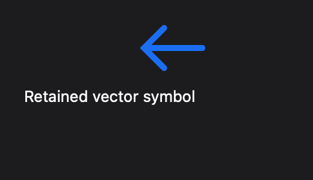

# Symbol verification

Local verification on 2026-10-31: arm64, macOS 27.0.1, Swift 6.4 in Swift 6 mode. Deployment remains macOS 26; this run does not qualify every supported OS/device combination.

## Automated evidence

- `just check`: formatting, strict tests (including SVG compiler and macro expansion), external API fixtures, isolated runtime faults, external Calculator build, host-only linkage check, release build, benchmark harness tests, and untimed layout validation.
- External fixtures use two consumer packages with `packageAccess: false`. An actor-isolated public author exports a nonisolated asset through only `import Stana`; a second package imports and compares it.
- Positive/negative literal and declaration cases, SVG feature validation, normalization, namespaces, XML safety, and every compile-time budget boundary are covered. Large invalid literals are generated by the fixture script rather than committed as repeated megabytes.
- Playback uses controlled time for exact samples, loop/once completion, request reuse and cancellation, transaction coalescing, independent mounts, visibility, reduced motion, disposal/remount, and failure recovery.
- Layout/scene tests cover constrained square fit, baseline, padding, zero size, RTL/effect ordering, unchanged semantic/hit geometry, old/new overflow damage, and extreme finite inputs without retry storms.
- Headless Core Graphics images cover currentColor versus literal paints, composited group opacity, transformed stroke overrides, arc holes, 1×/2× output, bounded preparation, cache sharing, both cache limits, eviction with live owners, and valid oversized transient preparations.
- `STANA_GUI_TESTS=1 MTL_DEBUG_LAYER=1 swift test --filter Symbol -Xswiftc -warnings-as-errors`: passed. Native checks cover the worker/Metal/capture path, incremental versus full redraw after animated overflow, stable semantic labels/bounds, RTL/dark theme, and hidden/detached attached surfaces. No Metal validation errors were reported.

This is a native renderer capture from the symbol verification window, not a Calculator screenshot.

## Existing session limitations

The full `STANA_GUI_TESTS=1 MTL_DEBUG_LAYER=1 just test-gui` run passed the symbol checks but failed two pre-existing GUI checks:

- Native input readiness: the probe's parent did not become active before opening its child.
- Cross-space chrome: native fullscreen did not complete within five seconds.

Both failures were reproduced with the same messages against an isolated, unchanged `main` checkout at `ec67cd0`. The standalone Calculator `--capture` command likewise reported “No completed offscreen frame” on both the feature branch and unchanged main; the Calculator smoke check did open a window and evaluate 2+2 correctly. No workaround or unrelated application-startup change is included here.

## Manual qualification

Interactive VoiceOver and physical display/presentation qualification were not performed. The automated semantic image/decorative projections and captures are not a substitute for a user-session VoiceOver walkthrough. IME behavior is unchanged by this feature; no new manual IME qualification is claimed.
