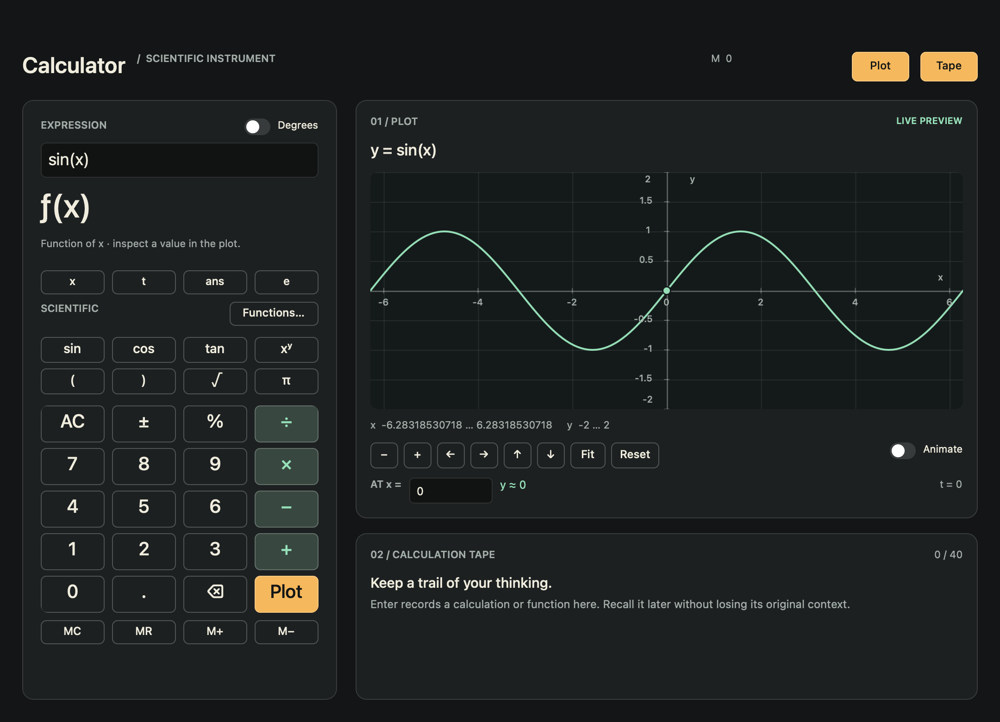

# Calculator

A numerical scientific calculator and graphing instrument built exclusively with the public `Stana` API. The example is an independent Swift package; it does not import AppKit, SwiftUI, or toolkit internals.

```sh
swift run --package-path Examples/Calculator
```

`just example` runs the same command. Requires Swift 6.4 and macOS 26 or newer.



This is a scene capture; the live window also retains the native traffic lights.

## Working with it

The left console keeps the expression, numerical preview, angle mode, and keypad together. Common scientific keys stay visible; **Functions…** opens a searchable library panel in the existing workspace, with descriptions and examples. Search focuses automatically; the keypad stays usable. Three functions are shown per page, avoiding a large nested scrolling surface. Done or insertion restores the plot/tape workspace. Keys and function insertion respect the expression's cursor and selection. The arithmetic layout includes all four operators.

- **Enter / =** records a scalar calculation in the tape. The expression stays visible and is selected for replacement. A digit starts a new expression; an operator continues from the unrounded numerical answer.
- **Plot** records expressions containing `x` as functions. It never substitutes `x = 0` to invent an answer, and it never changes scalar `ans` or memory. The plot previews syntactically valid expressions as you edit.
- **At x** evaluates the displayed plot at the specified finite numerical coordinate. The plot's `t` value is always visible. Animate sweeps the inspection point along any plotted function and advances `t` for time-dependent expressions. The entered formula never changes. Editing the inspection coordinate pauses animation; reduced motion disables it.
- Drag the plot in either direction to pan. Zoom changes both axes about the viewport center. **Fit** explicitly fits the vertical range to the central 90% of finite samples; **Reset** restores `x = ±2π`, `y = ±2`.
- The tape records the last 40 entries. **Recall** restores the original expression, angle mode, `ans` context, and time. **Copy** copies a scalar result at round-trip precision, or a function's expression.
- Plot and tape controls collapse the actual panels. If the plot is hidden, the tape uses the workspace. Viewport state survives hiding the plot.
- **MC / MR / M+ / M−** clear, recall, add, and subtract memory. Memory requires a valid scalar preview; a function or invalid expression cannot overwrite it.

Invalid drafts show no scalar result. A retained previous plot is explicitly labeled **Previous valid expression** and shows its actual source. Errors stay next to the expression; edit or clear to recover.

### Desktop commands

| Shortcut                             | Action                                                               |
| ------------------------------------ | -------------------------------------------------------------------- |
| Return in expression field / ⌘Return | Record expression / function                                         |
| ⌘K                                   | Clear expression                                                     |
| ⇧⌘F                                  | Function library                                                     |
| ⇧⌘C                                  | Copy numerical preview at full precision                             |
| ⇧⌘V                                  | Paste into the expression's selection                                |
| ⌘G                                   | Show / hide plot                                                     |
| ⇧⌘H                                  | Show / hide tape                                                     |
| ⌘S                                   | Export tape, including full-precision results and evaluation context |

Ordinary typing, selection, copy/paste, and native keyboard undo remain available in text fields. **Known public API limit:** keypad edits, recall, and other programmatic binding replacements reset the text field's native undo history. The example does not bypass this using private toolkit APIs. Explicit keypad editing cancels active IME composition; ordinary IME entry follows Stana's native text path.

File → Save Picture captures the complete offscreen scene. Export and capture use native save dialogs; failures are reported with alerts. Help → Copy Rendering Diagnostics is available for investigating native rendering failures.

## Numerical contract

This is a real-valued, binary64 numerical calculator, **not** a symbolic algebra system. Transcendental functions and plots are numerical approximations, not exact symbolic results. Display text uses 12 significant digits; `≈` indicates additional presentation rounding of a numerical result. Absence of `≈` is not a claim of symbolic exactness. Copy, export, continuation, and memory retain the underlying round-trip numerical value. Small nonzero values are not coerced to zero, and large fractional values are not snapped to integers.

- Operators: `+ − × ÷ ^ %`, or ASCII `+ - * /`, with parentheses. Multiplication must be explicit: use `2*x`, not `2x`.
- Precedence, strongest first: postfix `%`, exponentiation, unary signs, multiplication/division, addition/subtraction. Powers associate right: `2^3^2 = 512`; `-2^2 = -4`; `2^-3 = 0.125`.
- `%` divides the preceding operand by 100; it is not a contextual commercial percentage operation. `2^3%` means `2^(3/100)`.
- Numbers accept decimal points and scientific notation such as `1.25e-3`. Names are case-insensitive.
- Constants: `pi` / `π`, `e`, and `ans` (initially zero). `ans` changes only after a successful scalar submission.
- Variables: `x` is the graph coordinate; `t` is time in the displayed interval `0…2π` during animation. Scalar expressions containing `t` use the displayed time.
- `sin`, `cos`, `tan`, `asin`, `acos`, `atan`, and `atan2(y,x)` honor Degrees. Hyperbolic functions always use radians.
- `ln`, `log`, `log2`, `exp`, `sqrt`, `cbrt`, `abs`, `floor`, `ceil`, `round`, and `fact` take one argument. `round` resolves ties away from zero. `fact` accepts integers `0…170`.
- `min`, `max`, `mod`, `atan2`, and `pow` take two comma-separated arguments. `mod` is signed truncating remainder, so `mod(-7,3) = -1`.
- Division by zero, real-domain violations, `0^0`, `atan2(0,0)`, exactly represented tangent poles, and non-finite intermediates/results fail explicitly. Negative bases require integral exponents; use `cbrt` for negative cube roots.
- Floating-point rounding and underflow remain subject to binary64 arithmetic. Inputs extremely near a singularity can have large finite values; the engine does not round an arbitrary neighborhood to undefined.
- Input is bounded to 1,024 characters / 4,096 UTF-8 bytes and 64 expression-tree/nesting levels.

The plot has numbered ticks on both axes, x/y axis names, a range readout, a fixed initial viewport, and bounded adaptive sampling (at most 4,096 evaluations). It breaks at undefined samples and unresolved steep/nonlinear intervals rather than joining them. It is a sampled visualization: very narrow features or high-frequency oscillation may be missed, and Fit is a sampled heuristic—not a proof about the function's range.

History and memory are session-only. This version plots one explicit real-valued function; it does not solve equations, support complex arithmetic, or perform symbolic simplification.

## Design and implementation

The design follows the task sequence **calculate → inspect → revisit**. A stable console is adjacent to its plot; a collapsible expression/result tape preserves context without competing with the graph. Charcoal surfaces, warm text, mint signal color, and amber actions establish an instrument identity. Controls keep ordinary keyboard focus and semantic labels, support high contrast, and respect reduced motion. The window has a frameless appearance with a transparent full-size title bar, no native toolbar or title, and the real close/minimize/zoom traffic lights retained. The custom header is a native drag region; chrome-safe bounds prevent overlap with the system controls. Memory status lives in the custom header. Native window size and chrome-safe bounds drive plot geometry; no frame polling is needed for resizing.

Design references: [Desmos's expression/graph relationship](https://help.desmos.com/hc/en-us/articles/202529279-Desmos-Graphing-Calculator-User-Guide), [Soulver's readable calculation history](https://soulver.app/), [NumWorks's task-focused graphing controls](https://www.numworks.com/calculator/apps/grapher/), and [Nielsen's usability heuristics](https://www.nngroup.com/articles/ten-usability-heuristics/). This is a design-informed implementation, not a claim of completed user research.

The source tree groups responsibilities under `Sources/CalculatorApp`, using UpperCamelCase folder names consistently with the toolkit:

- `App/`: application entry point and window setup, with separate command, menu, and native-check files.
- `Components/`: calculator, graph, history, function catalog, and keypad components; `Components/UI/` contains reusable instrument controls.
- `Domain/`: numerical evaluation, plot sampling, and graph geometry.
- `State/`: calculator session transitions, editing, history, memory, and viewport state.
- `Models/`: keypad definitions.
- `Styles/`: visual tokens and window styling.
- `Utilities/`: PNG encoding for picture export.

The public toolkit currently exposes system-font sizes/weights, not custom font families; the example uses those supported capabilities rather than importing native typography APIs.

## Verification

```sh
swift test --package-path Examples/Calculator -Xswiftc -warnings-as-errors -Xcc -Werror
swift run --package-path Examples/Calculator CalculatorApp --self-check
swift run --package-path Examples/Calculator CalculatorApp --smoke-test
```

`--self-check` is a small headless compatibility check. The Swift Testing suite covers expression semantics/domains, formatting regressions, session transitions, contextual recall, cursor/selection edits, panel layouts, and graph sampling. `--smoke-test` requires a logged-in macOS window server.

For repeatable native visual inspection:

```sh
swift run --package-path Examples/Calculator CalculatorApp --capture /tmp/calculator.png
swift run --package-path Examples/Calculator CalculatorApp --compact --capture /tmp/calculator-compact.png
swift run --package-path Examples/Calculator CalculatorApp --wide --capture /tmp/calculator-wide.png
```

These modes bypass saved window frames, capture the actual scene, and quit. Manual VoiceOver and IME qualification must be recorded separately from automated checks.

Actual checks and remaining manual qualification are recorded in [Verification.md](Verification.md).
