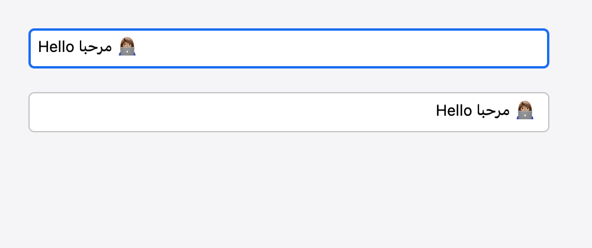

# Stana UI

A Swift toolkit for building desktop applications with retained UI, explicit state, and properties-first composition.

Compose a window once, then update its existing nodes through signals. Ordinary state changes do not rerun parent builders. Stana provides its own controls and rendering, with native windows, text services, and accessibility behind platform interfaces.

**Developer preview — macOS only today.** Stana is designed for cross-platform desktop applications, but Windows and Linux backends are not implemented. APIs may change; this preview makes no production-readiness or performance guarantees. See [platform support and limitations](Docs/PlatformSupport.md).

## A small example

```swift
import Stana

@main
struct CounterApp {
	@MainActor static func main() {
		let count = STNSignal(0)
		let window = STNWindow(properties: .init(title: "Counter", size: .init(width: 480, height: 320))) {
			STNVStack(properties: .init(spacing: 16, padding: 28)) {
				STNText(properties: .init(text: count.map { "Count: \($0)" }))
				STNButton(properties: .init(text: "Increment", onActivate: { count.value += 1 }))
			}
		}

		STNApplication.run(windows: [window])
	}
}
```

`count.map` creates a reactive value for the label. Reading `count.value` while building the label would capture a snapshot instead. Use `.value` inside actions to read or change state.

## What you can build with it

- **Reactive interfaces:** signals, computed values, synchronous transactions, explicit conditional and keyed regions, and reusable components with mount-scoped state and tasks.
- **Desktop layouts:** stacks, boxes, overlays, spacers, bitmap images, decorative canvas drawing, and vertical scrolling.
- **Interactive controls:** buttons, toggles, focus groups, and single-line text fields with selection, grouped undo, styling, and native macOS text services.
- **Desktop integration:** configurable windows, frameless windows, panels, sheets, tabs, toolbars, menus, keyboard shortcuts, clipboard access, file dialogs, and alerts.
- **Headless testing:** the `StanaTesting` product provides deterministic consumer test hosts without starting a native application.

The macOS backend uses Core Graphics and Core Text, with a private Objective-C bridge to AppKit. Consumer code imports `Stana`, not AppKit or SwiftUI.

## Try it

### Requirements

- macOS 26 or later.
- Swift 6.4 or newer, using Swift 6 language mode and a macOS SDK.
- A logged-in graphical macOS session to open example windows.

Check your toolchain with `swift --version`, then run the Counter example:

```sh
git clone https://github.com/tuuls-dev/stana-ui.git
cd stana-ui
swift run --package-path Examples/Counter
```

No third-party Swift package dependencies are required. [Just](https://github.com/casey/just) is optional; if installed, `just example Counter` runs the same example.

### Use Stana in your own app

Create a SwiftPM executable package with this `Package.swift`:

```swift
// swift-tools-version: 6.4
import PackageDescription

let package = Package(
	name: "Counter",
	platforms: [.macOS(.v26)],
	dependencies: [
		.package(url: "https://github.com/tuuls-dev/stana-ui.git", exact: "0.0.1")
	],
	targets: [
		.executableTarget(
			name: "CounterApp",
			dependencies: [.product(name: "Stana", package: "stana-ui")]
		)
	],
	swiftLanguageModes: [.v6]
)
```

Save the [small example above](#a-small-example) as `Sources/CounterApp/App.swift`, then run `swift run CounterApp`. Keep the filename `App.swift` when using the `@main` entry point. This manifest pins the preview version explicitly.

To work against a local checkout instead, replace the URL dependency with `.package(path: "../stana-ui")`, adjusting the path to your checkout. The included examples use local package dependencies.

## Examples

Each example is an independent consumer package using the public API. Run one with `swift run --package-path Examples/<Name>` or `just example <Name>`.

| Example                                             | Demonstrates                                                       |
| --------------------------------------------------- | ------------------------------------------------------------------ |
| [Counter](Examples/Counter)                         | Signals, retained label updates, and a shared button/menu command. |
| [Preferences](Examples/Preferences)                 | Editable settings and a reusable labelled-field component.         |
| [EditableCollection](Examples/EditableCollection)   | Keyed observable rows and editing state during collection updates. |
| [WindowConfiguration](Examples/WindowConfiguration) | Window settings, native relationships, and chrome.                 |
| [TextFields](Examples/TextFields)                   | Styled single-line fields and text-service configuration.          |

### Text-field rendering



An offscreen rendering capture; see [text-field verification](Docs/Verification/TextFields.md) for its scope and pending manual checks.

## Documentation

- [Getting started](Sources/Stana/Documentation.docc/GettingStarted.md)
- [State and bindings](Sources/Stana/Documentation.docc/StateAndBindings.md)
- [Custom components and lifetimes](Sources/Stana/Documentation.docc/CustomComponents.md)
- [Text fields](Sources/Stana/Documentation.docc/TextFields.md)
- [Desktop applications](Sources/Stana/Documentation.docc/DesktopApplications.md)
- [Window configuration](Sources/Stana/Documentation.docc/WindowConfiguration.md)
- [Architecture](Docs/Architecture.md)
- [Platform support and qualification](Docs/PlatformSupport.md)

The [DocC catalog](Sources/Stana/Documentation.docc) lives alongside the public API in `Sources/Stana`.

## Current boundaries

Scrolling mounts all children; there is no virtualized list. Multiline editing, selectable display text, grids, SVG interpretation, and an animation framework are not included. Rendering is currently CPU raster on the UI executor.

Native services depend on the OS and device configuration. User-session VoiceOver and IME qualification remains separate from automated tests. Consult the [verification results](Docs/Verification/Results.md) and [platform support](Docs/PlatformSupport.md) before relying on a feature.

## Development

Run these commands from the repository root:

| Command                             | Purpose                                                                                                                     |
| ----------------------------------- | --------------------------------------------------------------------------------------------------------------------------- |
| `just`                              | List available recipes.                                                                                                     |
| `just build`                        | Build the library in debug mode.                                                                                            |
| `just test`                         | Run tests with Swift and native warnings treated as errors.                                                                 |
| `just check`                        | Run formatting, boundary checks, tests, API fixtures, runtime probes, all example builds, and a release build sequentially. |
| `just format` / `just check-format` | Format Swift files or check without edits.                                                                                  |
| `just test-gui`                     | Run opt-in native GUI tests in a logged-in macOS session.                                                                   |
| `just benchmark`                    | Run the release-mode headless benchmark and print JSON.                                                                     |

Without Just, use `swift build`, `swift test -Xswiftc -warnings-as-errors -Xcc -Werror`, and the scripts described in [CONTRIBUTING.md](CONTRIBUTING.md).

To assemble an unsigned example application:

```sh
Scripts/package-macos-app.sh Examples/Counter CounterApp dev.example.counter
```

The script requires Python 3 and creates `dist/CounterApp.app`. Signing and notarization are application-owned steps.

## Help and contributing

Report bugs or propose improvements through [GitHub Issues](https://github.com/tuuls-dev/stana-ui/issues). Include a minimal reproduction, your macOS and Swift versions, and any relevant diagnostics.

Before contributing, read [CONTRIBUTING.md](CONTRIBUTING.md) for API fixtures, formatting conventions, verification, and release instructions.

## License

No license file is currently included in this repository.
